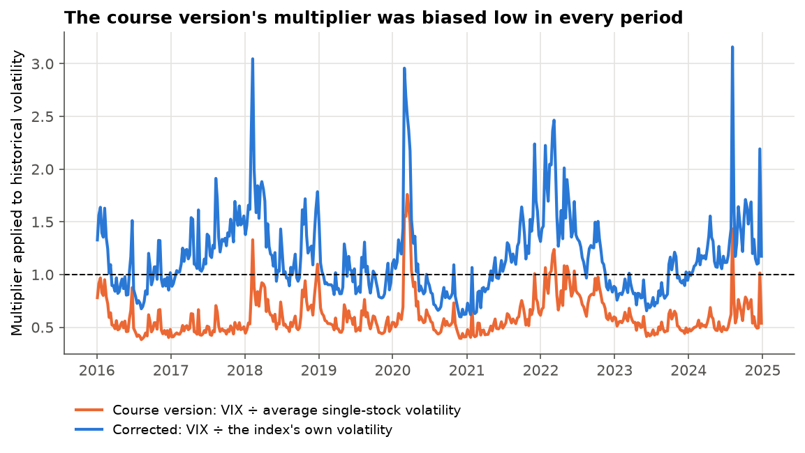
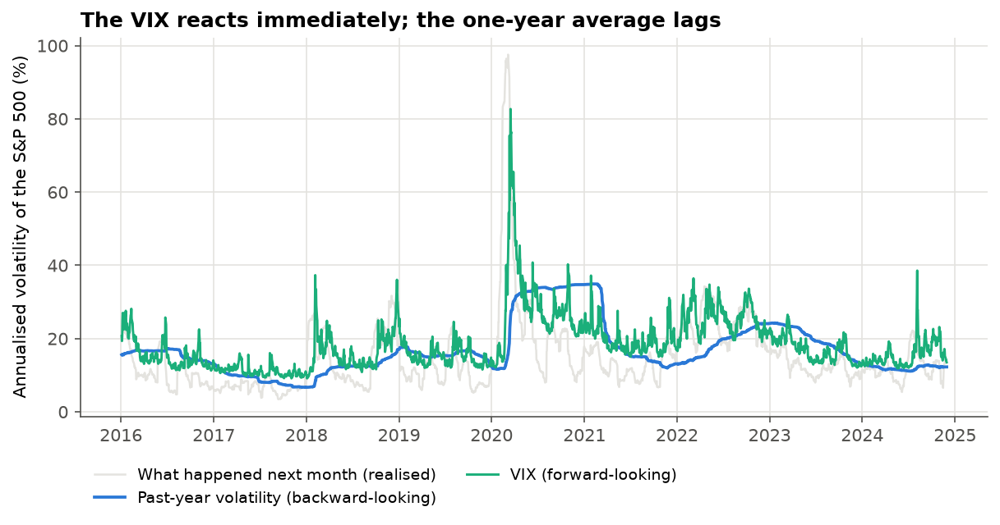
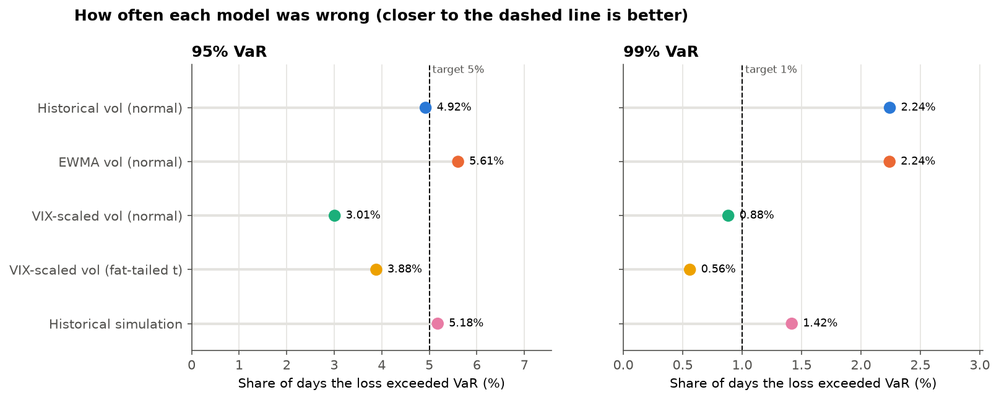
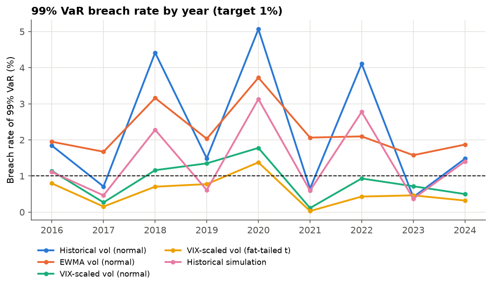
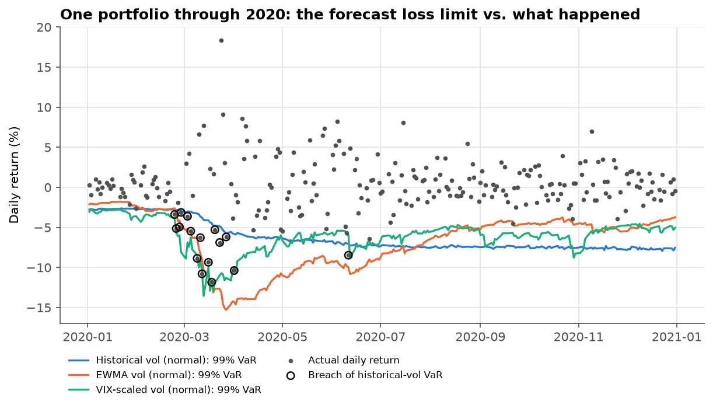
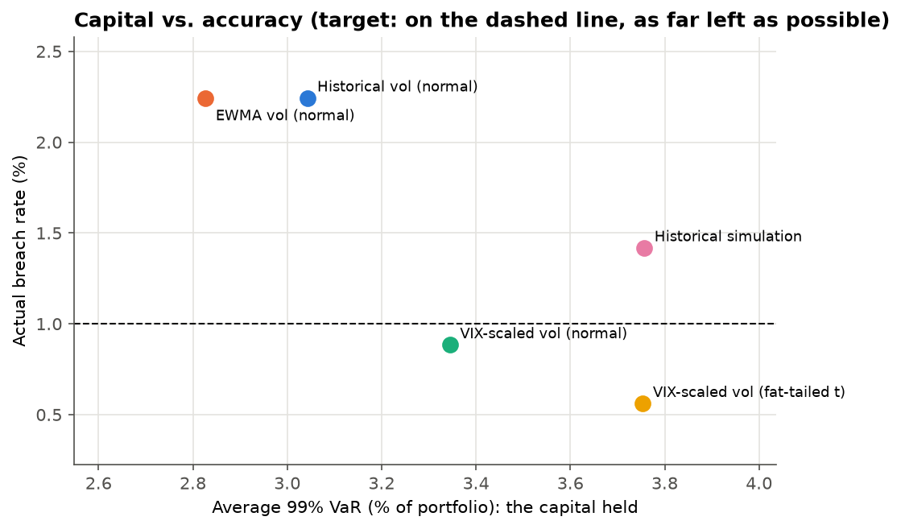
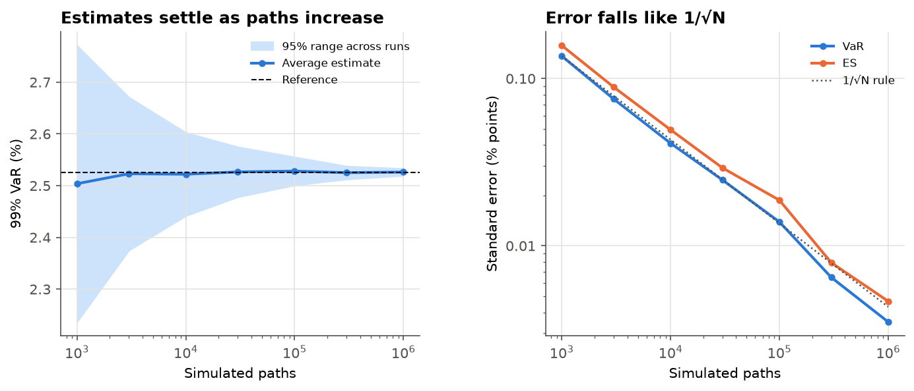
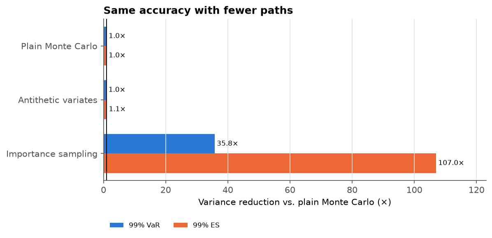

## Summary

Every day, banks and fund managers estimate *"how much could we lose tomorrow?"* and set money aside against the answer. This project tested five ways of making that forecast. It built Monte Carlo simulations for **900 randomly chosen five-stock portfolios** of S&P 500 companies and produced a forecast **every trading day from 2016 to 2024**: **216,975 forecasts per model**. Each forecast was then checked against what actually happened, using data from Wharton Research Data Services (WRDS).

| | Result |
|----|----------------|
| **Best model** | Scaling past volatility by the options market's fear gauge (the **VIX**). Its "1-in-100 days" loss limit was exceeded on **0.88%** of days, close to the promised 1%. |
| **Textbook model** | Using only the past year's volatility, the limit was exceeded on **2.24%** of days, more than twice as often as promised. **26%** of portfolio-years fell in the regulators' "red zone", against **under 1%** for the VIX model. |
| **When it matters** | In **March 2020** the textbook model's limit was exceeded on **34%** of days, the VIX model's on **12%**. |
| **Cost** | The VIX model holds about **10% more** capital than the textbook model, and **11% less** than historical simulation, the method most banks use, while being more accurate than both. |
| **Course-version error** | The original project's headline ("history overstates risk by about 2×") came from comparing a whole index with single stocks. Done like for like, options were on average pricing **16% more** risk than the past year showed. |
| **Simulation quality** | Standard error of ±0.04 percentage points at 10,000 paths. **Importance sampling** gave the same accuracy with **36×** (VaR) to **107×** (ES) fewer paths. |

## 1. The question

**Value-at-Risk (VaR)** is the most widely used risk number in finance: *"there is a 99% chance this portfolio will not lose more than X% tomorrow."* Its companion, **Expected Shortfall (ES)**, gives the *average* loss on the 1-in-100 days when that limit is exceeded. Regulators require banks to compute both, and firms hold capital against them.

Like a weather forecast, a VaR can only be judged by keeping score. A 99% VaR should be exceeded ("**breached**") on about 1 day in 100. More often, and the firm is under-protected. Less often, and it is tying up money for nothing.

The key input is **volatility**, how much prices swing. It can be estimated **backwards**, from how much prices moved over the past year, or **forwards**, from option prices, which reveal how much movement traders expect. For the S&P 500 index, the options market's expectation is published every day as the **VIX**, often called the "fear index". This project asks which approach gives forecasts that keep their promise, and what each one costs in capital.

## 2. What changed from the course version

The first version of this project (the course submission) compared the two approaches for 29 stocks. It concluded that historical volatility overstated risk by about 2×, because its "options-implied" multiplier came out at 0.53. Reviewing that work turned up three problems:

1. **It compared an index with single stocks.** It divided the VIX (the volatility of the *whole S&P 500 index*) by the average volatility of *individual stocks*. An index of 500 stocks is always calmer than a typical single stock, because their individual ups and downs partly cancel out. The ratio was mostly measuring diversification, not market sentiment.
2. **Survivorship bias.** The 29 stocks were the first tickers alphabetically on *today's* S&P 500 list, so companies that had failed or been dropped were missing.
3. **No reality check.** The forecasts were never compared with what actually happened.

Figure 1 shows the first problem directly. The course version's multiplier (orange) was **below** the like-for-like one (blue, VIX ÷ the index's *own* volatility) on **every one of the ~450 dates** checked, and about half its size on average (0.60 against 1.16). Done correctly, options were on average pricing *more* risk than the past year showed. The original headline was an artefact of the comparison.

{width=95%}

## 3. Data

All data comes from **WRDS**, the standard research database in academic finance:

| Source | What was used | Size |
|-------|---------|-------|
| CRSP daily stock file | Daily total returns (dividends included) | 1.59 million stock-days, 736 companies |
| CRSP S&P 500 constituents | When each company joined and left the index | 741 membership spells |
| CRSP daily index file | Daily return of the S&P 500 | 2,516 days |
| Cboe (via WRDS) | Daily VIX | 2,516 days, from 9.1 to 82.7 |

**Survivorship bias removed.** Each January, portfolios were drawn only from companies in the index *on that day* (about 500 usable each year). Between 17 and 39 companies joined or left the index every year, so this matters.

**A change from the proposal.** The proposal planned to use each stock's *own* implied volatility from OptionMetrics. The WRDS subscription available for this project turned out to include only a sample of OptionMetrics, and Cboe's stock-level option data was not licensed. The forward-looking models therefore use the **VIX**, which is available in full. They compare it with the index's own history and use the ratio to scale every stock's volatility. Stock-level implied volatility remains the natural next step (§9).

**Data handling.** Missing returns were never filled in, since filling a gap invents a calm day. A portfolio was skipped on any day one of its stocks had no data. That affected 4.2% of portfolio-days, mostly portfolios holding a company that was acquired mid-year. Under the WRDS licence, raw data is not published; only code and summary results are.

## 4. What the data showed before modelling

The notebook explores the data before building anything. Each finding shaped a design choice:

* **Extreme days are far more common than a bell curve allows.** Moves beyond 4 standard deviations happened on 0.67% of stock-days, about **100× more often** than a normal distribution predicts. This stays true after allowing for calm and stormy periods. *Design choice:* *A fat-tailed (Student-t) model was added.*
* **Volatility comes in waves.** The size of today's move predicts the size of moves for weeks ahead. One-month volatility of the average stock ranged from 4% to 108% (April 2020). *Design choice:* *Faster models (EWMA, VIX) were tested against the slow one-year average.*
* **The VIX reacts immediately; the one-year average lags** (Figure 2). The VIX's correlation with the *next* month's actual volatility was **0.62**, against **0.23** for the past-year average. The VIX also usually sits above what follows (median ratio 1.39), because option buyers pay a premium for protection. *Expectation:* *VIX-based models should be safe, possibly over-cautious.*
* **Stocks move together more in a crisis.** Their average correlation is about 0.28 normally and peaked at 0.67 in March 2020, when diversification fails. *Limitation:* *every model takes correlations from the past year.*

{width=95%}

## 5. How the simulation works

For each portfolio and day, each model:

1. measures each stock's volatility (by the model's rule) and how the stocks move together over the past year;
2. draws 10,000 sets of random shocks and uses a **Cholesky decomposition** so that they move together like the real stocks;
3. turns each set into a possible portfolio return for tomorrow;
4. sorts the 10,000 outcomes: the 100th-worst is the 99% VaR, the average of the 100 worst is the 99% ES.

The five models:

| Model | Volatility used | Shape of shocks |
|------|-----------|------|
| Historical vol | Past 252 days, all equally weighted (the textbook approach) | Bell curve |
| EWMA vol | Past days, recent ones weighted more (RiskMetrics, λ = 0.94) | Bell curve |
| **VIX-scaled vol** | Past-year vol × (VIX ÷ index's past-year vol) | Bell curve |
| VIX-scaled, fat-tailed | Same | Student-t, tail thickness re-fitted each year |
| Historical simulation | None: replays the portfolio's last 250 actual days | Actual history |

Every model and portfolio uses the **same random numbers** each day, so differences between models cannot be simulation luck. Every forecast uses only data available the evening before. The notebook checks this by corrupting all future data and confirming that the forecast doesn't change.

## 6. Results

### Which model kept its promise?

**99% VaR (target: breached on 1% of days)**

| Model | Avg. VaR | Breach rate | Basel green | Basel red | Breaches bunched\* | ES ratio\*\* | Quantile loss\*\*\* |
|-----------------|------|------|------|------|-------|------|------|
| Historical vol | 3.04% | 2.24% | 55% | 26% | 13.0% | 1.31 | 6.10 |
| EWMA vol | 2.83% | 2.24% | 37% | 9% | 6.3% | 1.16 | 4.83 |
| **VIX-scaled vol** | 3.34% | **0.88%** | **88%** | **0.6%** | **1.1%** | 1.12 | **4.35** |
| VIX-scaled, fat-tailed | 3.75% | 0.56% | 97% | 0% | 0.7% | **0.92** | 4.41 |
| Historical simulation | 3.76% | 1.42% | 68% | 3% | 11.0% | 1.17 | 5.69 |

\* Share of portfolio-years where the Christoffersen test finds breaches bunching together (about 5% expected by chance).
\*\* Actual average loss on breach days ÷ forecast ES; 1.0 is perfect, above 1 means bad days were worse than forecast.
\*\*\* A single score that rewards accuracy and penalises over-caution; lower is better.
*Basel* zones count breaches per portfolio-year: green ≤ 4, yellow 5–9, red ≥ 10.

{width=100%}

* **The backward-looking models break their promise at 99%.** Historical vol and EWMA were each breached on 2.24% of days. A quarter of the historical model's portfolio-years would have been in the regulators' red zone, which triggers the highest capital penalty.
* **The VIX-scaled model came closest to target** and had the best overall score (lowest quantile loss), the most green-zone years among the bell-curve models, and almost no bunching of breaches.
* **Fat tails on top over-correct.** The fat-tailed VIX model is the safest (no red zones) and gets the size of bad days right (ES ratio 0.92), but breaches too rarely and costs more capital.
* **At the 95% level the picture is different.** There the backward-looking models are close to target (historical 4.92%, EWMA 5.61%, historical simulation 5.18%), and EWMA is the best calibrated portfolio by portfolio. The VIX models are too cautious (3.0–3.9%). The VIX's built-in premium over-protects on *ordinary* bad days and is exactly what keeps it safe on *extreme* ones.
* **No model is perfect for every portfolio.** For every model, 20–40% of individual portfolio-years fail the Kupiec test. A five-stock portfolio carries stock-specific shocks (earnings surprises, takeovers) that a market-wide volatility forecast cannot see.

### When do models fail?

{width=95%}

The historical model's failures cluster in exactly the years that matter: **2018** (the February volatility spike and Q4 sell-off), **2020** (COVID) and **2022** (the rate-hike bear market), at 4–5× its target. In the calm years after each storm (2021, 2023) it swings the other way, far below target, because its one-year memory still holds the storm. It is wrong in both directions, at the wrong times. The VIX-scaled model stayed between 0.1% and 1.8% in every year.

Figure 5 follows one portfolio through 2020. The historical model's loss limit (blue) barely moves as markets crash in March, so loss after loss breaks through it. The VIX-scaled limit (green) widens within days. After the crash, the historical limit stays wide for the rest of the year, long after markets have calmed.

{width=95%}

### Capital vs. accuracy

{width=80%}

The VIX-scaled model holds about **10% more capital** than the historical model, but cuts its 99% breach rate by more than half and its red-zone years from 26% to under 1%. Compared with **historical simulation**, the most common method at banks, it is both **more accurate and 11% cheaper**. EWMA is the cheapest, because it forgets past storms fastest, but it is breached just as often as the historical model.

## 7. Is the simulation itself accurate?

A Monte Carlo answer is an estimate, so its precision was measured directly by re-running one forecast many times at each path count:

* **Accuracy behaves as theory predicts.** The error falls in proportion to 1/√N: four times the paths halves the error. At the 10,000 paths used in the backtest, the 99% VaR is accurate to ±0.04 percentage points, against differences of 0.3–0.7 points between models.
* **The engine matches the textbook formula.** For the bell-curve case, the simulated 99% VaR (2.29%) is within 2% of the closed-form answer (2.33%). The small gap is expected, because the simulation uses exact (simple) returns.
* **Antithetic variates** (pairing each scenario with its mirror image) gave **no** improvement in the tail (0.95–1.05×). That is expected for a symmetric distribution, because a tail scenario's mirror image lands in the opposite tail.
* **Importance sampling** deliberately simulates more of the rare bad scenarios and re-weights them so the answer stays unbiased. It reduced the variance **36×** for VaR and **107×** for ES: the accuracy of plain simulation with 36 to 107 times fewer paths.

{width=95%}

{width=75%}

## 8. Did the project meet its success criteria?

| Criterion from the proposal | Outcome |
|--------|------------|
| A validated simulation engine whose error behaves as theory predicts | **Met.** Covariance reproduced to within 0.4%, closed form matched within 2%, error proportional to 1/√N, no look-ahead (verified) |
| A statistically supported ranking of the models, including *when* each fails | **Met.** Kupiec, Christoffersen and Basel tests on 900 portfolio-years; failures located in 2018, 2020 and 2022 |
| Quantify how much the volatility assumption changes required capital | **Met.** Up to a 33% spread in average 99% VaR between models (2.83% to 3.76%) |
| A forward-looking model that beats the baselines in crises, or matches them with less capital | **Met.** The VIX-scaled model beat every backward-looking model in every crisis year, and beat historical simulation on both accuracy and capital |
| Use stock-level implied volatility (OptionMetrics) | **Not met.** Not in the available WRDS subscription; replaced by the VIX, compared like for like |

## 9. What this means in practice

* **A risk model that looks only backwards is wrong at the worst times.** It understates risk as a crisis begins and overstates it once the crisis is over.
* **The options market is a useful early-warning signal, if it is compared like for like.** Comparing an index's implied volatility with single stocks, as the course version did, produces a large and misleading gap.
* **"Safer" and "better" are not the same.** The fat-tailed model was the safest but held 23% more capital than the historical model. The plain VIX model gave the best balance.
* **Model risk is real.** Five reasonable models gave average capital figures up to a third apart and very different crisis behaviour. Comparing several models, as here, is more informative than trusting one.

### Limitations and next steps

* **Market-wide signal only.** The VIX scales all stocks' volatility by the same factor, so it misses stock-specific news. Stock-level implied volatility (OptionMetrics) is the natural refinement.
* **Correlations are backward-looking.** All models take correlations from the past year, but correlations more than doubled in March 2020. Forecasting correlations (e.g. a DCC-GARCH model) is a next step.
* **Stylised portfolios.** Equal-weight five-stock portfolios make a demanding test but are not institutional portfolios.
* **One-day horizon only.** Regulatory capital also uses 10-day horizons.
* **Delisting returns.** Portfolio-days after a stock left CRSP were skipped rather than charged the final delisting return.
* **Importance sampling** was demonstrated on one forecast; building it into the backtest would cut its run time sharply.

## Glossary

* **Volatility**: how much a price typically swings.
* **VaR (99%)**: a loss that should be exceeded on only 1 day in 100. **ES**: the average loss on those days.
* **Breach**: a day when the actual loss exceeded the VaR forecast.
* **VIX**: the options market's forecast of S&P 500 volatility over the next 30 days.
* **Monte Carlo simulation**: answering a question about uncertainty by simulating many random scenarios.
* **Backtest**: checking past forecasts against what actually happened.
* **Basel traffic light**: the regulators' scorecard for VaR models (green, yellow, red by number of breaches a year).
* **Survivorship bias**: the distortion from studying only companies that survived.

## References

* Basel Committee on Banking Supervision (1996). *Supervisory framework for the use of "backtesting" in conjunction with the internal models approach to market risk capital requirements.* BIS.
* Christoffersen, P. (1998). Evaluating interval forecasts. *International Economic Review*, 39(4), 841–862.
* Glasserman, P. (2004). *Monte Carlo Methods in Financial Engineering.* Springer.
* J.P. Morgan/Reuters (1996). *RiskMetrics — Technical Document* (4th ed.).
* Jorion, P. (2007). *Value at Risk: The New Benchmark for Managing Financial Risk* (3rd ed.). McGraw-Hill.
* Kupiec, P. (1995). Techniques for verifying the accuracy of risk measurement models. *Journal of Derivatives*, 3(2), 73–84.

*Data: CRSP and Cboe via Wharton Research Data Services. Code and full analysis: the project notebook (notebooks folder).*
